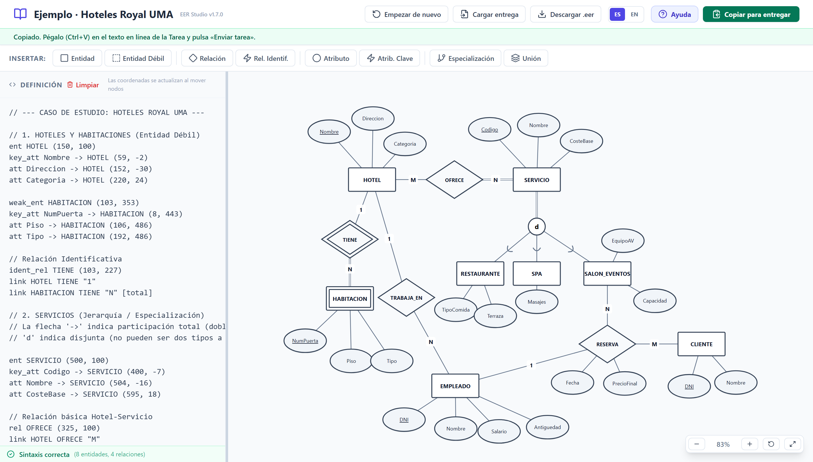
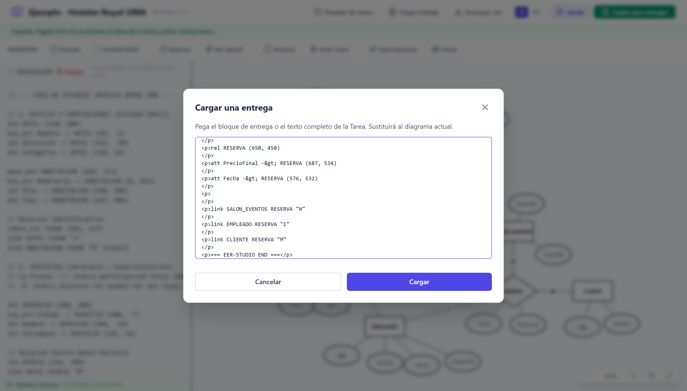
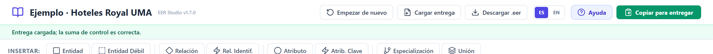

# Guía del profesor: examen EER en Moodle con EER Studio

> Versión en PDF para compartir: [`GUIA_PROFESOR.pdf`](./GUIA_PROFESOR.pdf). Se genera con `typst compile docs/moodle/main.typ docs/moodle/GUIA_PROFESOR.pdf` a partir de `main.typ` (portada), `styles.typ` (estilos) y `guia-profesor.typ` (contenido). Si cambias esta guía, actualiza también `guia-profesor.typ`.

**EER Studio** es un editor de diagramas Entidad-Relación Extendido creado por **David Bueno Vallejo** (Universidad de Málaga), con licencia MIT ([código fuente](https://github.com/davidbuenov/dbv-eer-studio)). Su **edición Moodle** permite hacer un examen de modelado EER dentro del Campus Virtual (Moodle 5):

- funciona en un **aula sin internet**: basta con que el navegador llegue al servidor Moodle;
- está pensada para **Safe Exam Browser** (SEB);
- incluye **solo el editor EER**: sin modelo relacional, SQL, prompt de IA ni ficheros;
- se **autoguarda**, y la entrega queda **bloqueada** cuando el alumno la envía o cuando se cierra la Tarea.

---

## 1. La idea: dos actividades

El examen se monta con **dos actividades**, una junto a otra en la misma sección del curso:

| | Actividad | Para qué sirve |
| --- | --- | --- |
| ① | **Paquete SCORM «Examen EER»** | El alumno **dibuja** el diagrama. Es solo la mesa de trabajo: no guarda nada en Moodle. |
| ② | **Tarea «Entrega del examen EER»** | El alumno **entrega**: pega su diagrama en el texto en línea y pulsa «Enviar tarea». **Es lo único que cuenta y lo único que corriges.** |

**El recorrido del alumno:**

1. Abre el SCORM. El editor arranca con la plantilla del examen, si la hay.
2. Dibuja con el ratón o escribiendo código. Todo se autoguarda en el navegador.
3. Pulsa **«Copiar para entregar»**. Aparece el aviso verde *«Copiado…»*.
4. Abre la Tarea, pega el bloque (Ctrl+V), pulsa *Guardar cambios* y después **«Enviar tarea»**.

Si después vuelve al SCORM, puede seguir dibujando, pero **eso ya no cambia lo que entregó**.



### El bloque de entrega

Lo que el alumno pega en la Tarea tiene este aspecto:

```text
=== EER-STUDIO BEGIN v1 ===
// EER Studio · edición Moodle · © 2025-2026 David Bueno Vallejo (Universidad de Málaga) · https://github.com/davidbuenov/dbv-eer-studio
// eer-studio-moodle app=1.7.0 exam=exam-01b5a86c date=2026-11-13T06:25:56.429Z checksum=9188dc84
ent HOTEL (150, 100)
key_att Nombre -> HOTEL (59, -2)
...
=== EER-STUDIO END ===
```

- La **primera línea de comentario** es el crédito de autoría de EER Studio. Va en todas las entregas y en todos los `.eer` descargados.
- La **segunda** son los metadatos: versión, examen, fecha y hora de la copia (UTC) y **suma de control**. La suma de control permite detectar si el texto se modificó a mano después de copiarlo.
- Después viene el **código DSL** del diagrama, que es lo que se corrige.

---

## 2. Conseguir el paquete del examen

### 2.1. Descargar los paquetes ya generados

La **última versión** de los paquetes está siempre en la carpeta [`dist-moodle`](https://github.com/davidbuenov/dbv-eer-studio/tree/main/dist-moodle) del repositorio en GitHub, y la de esta guía en [`docs/moodle`](https://github.com/davidbuenov/dbv-eer-studio/tree/main/docs/moodle). Los enlaces de descarga directa no cambian entre versiones:

| Fichero | Qué es |
| --- | --- |
| [`eer-studio-moodle-vacio_scorm12.zip`](https://github.com/davidbuenov/dbv-eer-studio/raw/main/dist-moodle/eer-studio-moodle-vacio_scorm12.zip) | Examen con el **editor vacío**, listo para subir a Moodle. |
| [`eer-studio-moodle-ejemplo-hotel_scorm12.zip`](https://github.com/davidbuenov/dbv-eer-studio/raw/main/dist-moodle/eer-studio-moodle-ejemplo-hotel_scorm12.zip) | Examen de **ejemplo**, que arranca con el diagrama del caso «Hoteles Royal UMA». Útil para probar el flujo completo. |
| [`eer-studio-moodle-vacio.html`](https://github.com/davidbuenov/dbv-eer-studio/raw/main/dist-moodle/eer-studio-moodle-vacio.html) | El examen vacío suelto: se abre con doble clic y sirve de **visor para corregir** (§6). |

### 2.2. Generar un paquete con tu plantilla

Para que el examen arranque con tu enunciado o tus entidades ya colocadas, genera el paquete con el repositorio de EER Studio y Node.js 22.2 o posterior:

```bash
npm install                      # solo la primera vez

# Sin plantilla (editor vacío)
npm run build:moodle

# Con plantilla de partida y título
npm run build:moodle -- --template examenes/hotel.eer --title "Examen BD · Junio 2026"
```

| Opción | Para qué sirve |
| --- | --- |
| `--template <fichero.eer>` | Código con el que arranca el editor: enunciado en comentarios, entidades ya colocadas… |
| `--title "<texto>"` | Título visible en la barra del examen y en Moodle. |
| `--id <id>` | Identificador del examen. Por defecto se calcula a partir del título y la plantilla. |
| `--name <nombre>` | Nombre de los ficheros generados. Por defecto, el título sin acentos ni espacios. |

Se generan dos ficheros en `dist-moodle/`:

- **`<nombre>_scorm12.zip`**: el que se sube a Moodle.
- **`<nombre>.html`**: el mismo examen suelto. Se abre con doble clic para probarlo y sirve de **visor para corregir** (§6).

> ⚠️ **La plantilla va dentro del paquete y cualquier alumno puede leerla.** No pongas la solución en ella.

> El identificador del examen es la clave del autoguardado. Si regeneras el paquete con el mismo título y la misma plantilla (o el mismo `--id`), los alumnos que ya hayan empezado conservan su trabajo.

---

## 3. Configurar las dos actividades en Moodle

Aplica a las dos **las mismas restricciones de acceso**: fechas, grupo, contraseña o Safe Exam Browser.

### 3.1. Paquete SCORM «Examen EER»

*Añadir una actividad o recurso → Paquete SCORM*, y sube el `.zip`.

| Sección | Ajuste | Valor | Motivo |
| --- | --- | --- | --- |
| Apariencia | **Mostrar paquete** | **Ventana actual** | SEB suele bloquear las ventanas nuevas. |
| Apariencia | **Mostrar la estructura del curso en el reproductor** | **Oculto** | Quita el botón `>` del índice lateral. |
| Apariencia | **Mostrar navegación** | **No** | Quita los botones `<< < ^ > >>` de debajo del editor. |
| Calificación | **Método de calificación** | Objetos de aprendizaje | El SCORM no califica: solo marca «completado» cuando el alumno copia su entrega. |
| Gestión de intentos | **Número de intentos** | Sin límite | Volver a entrar no debe consumir intentos. |

### 3.2. Tarea «Entrega del examen EER»

*Añadir una actividad o recurso → Tarea*.

| Sección | Ajuste | Valor |
| --- | --- | --- |
| Disponibilidad | **Permitir entregas desde** | Inicio del examen. |
| Disponibilidad | **Fecha de entrega** | Fin del examen. |
| Disponibilidad | **Fecha límite** | Fin del examen (o unos minutos de margen). **A partir de esta fecha, Moodle no acepta ni deja modificar entregas.** |
| Tipos de entrega | **Texto en línea** | ✅ activado y **sin límite de palabras**. |
| Tipos de entrega | **Archivos enviados** | Opcional, como alternativa con `.eer` (§5). |
| Configuración de entrega | **Requiere que los alumnos pulsen el botón de envío** | **Sí**: tras «Enviar tarea», la entrega queda bloqueada. |
| Configuración de entrega | **Requiere que los alumnos acepten las condiciones de entrega** | Recomendado. |
| Configuración de entrega | **Reabrir intentos** (o **Intentos adicionales**, según la versión) | **Nunca**. |

Con estos ajustes, **nadie puede modificar su entrega después de enviarla o una vez cerrada la Tarea**, aunque vuelva a abrir el SCORM. Esa garantía la da Moodle, no la app.

### 3.3. Instrucciones para el alumnado

Puedes pegar este texto en la descripción de la Tarea:

> 1. Abre la actividad **«Examen EER»** y haz tu diagrama. Se guarda solo: puedes venir aquí y volver sin perder nada.
> 2. Cuando termines, pulsa el botón verde **«Copiar para entregar»**.
> 3. Vuelve a esta Tarea, pulsa *Agregar entrega*, pega el texto (**Ctrl+V**) y pulsa *Guardar cambios*.
> 4. Comprueba que el texto empieza por `=== EER-STUDIO BEGIN v1 ===` y termina por `=== EER-STUDIO END ===`.
> 5. Pulsa **«Enviar tarea»**. A partir de ese momento ya no podrás cambiarlo.

---

## 4. Aula sin internet y Safe Exam Browser

- **Sin internet**: el paquete lleva dentro todo el código, los estilos y los iconos, y no hace ninguna petición de red.
- **Navegador normal**: probado en el Campus Virtual de la UMA. El editor se carga dentro del reproductor SCORM y «Copiar para entregar» funciona.
- **Safe Exam Browser**:
  - Permite el dominio del Campus Virtual en la configuración del examen.
  - Copiar y pegar dentro de SEB funciona entre páginas del propio SEB, porque usa su propio portapapeles. **No desactives el portapapeles**, o el alumno no podrá pegar el bloque en la Tarea.
  - SEB bloquea las descargas por defecto: **en SEB no se usa «Descargar .eer»**, solo el texto en línea.
  - Al salir de SEB se borran los datos del navegador, autoguardado incluido. Lo entregado ya está en la Tarea.
- **PCs compartidos sin SEB**: el autoguardado caduca a las 12 horas. Con turnos seguidos en el mismo equipo, pide a cada alumno que pulse **«Empezar de nuevo»** al terminar, o genera un paquete distinto por turno (`--id`).

### Lista de comprobación antes del examen real

En un curso de pruebas, con un usuario de **rol alumno** y **dentro de SEB**:

- [ ] El SCORM se abre en la ventana actual y muestra el editor con la plantilla.
- [ ] Al ir a la Tarea y volver al SCORM, el diagrama sigue ahí (aviso *«Se ha recuperado el trabajo…»*).
- [ ] «Copiar para entregar» muestra el aviso verde. Si aparece la ventana *«Copia tu entrega»*, el alumno copia con Ctrl+C.
- [ ] El bloque se pega en el texto en línea de la Tarea y se envía.
- [ ] Ya enviada, la Tarea no deja editar la entrega.
- [ ] Como profesor, el bloque de esa entrega se carga en el visor con la suma de control correcta (§6).

---

## 5. Entrega alternativa por fichero (sin SEB)

Si la Tarea admite *Archivos enviados*, el alumno puede pulsar **«Descargar .eer»** y subir el fichero.

El `.eer` empieza por las mismas líneas de crédito y metadatos, que son comentarios del DSL, así que se abre sin cambios en la edición completa de EER Studio (web o escritorio).

---

## 6. Revisar y corregir las entregas

**Para ver un diagrama:**

1. En la Tarea, abre la entrega del alumno y copia el texto. También vale el HTML que guarda Moodle.
2. Abre el `<nombre>.html` del examen con doble clic y pulsa **«Cargar entrega»**.
3. Pega y pulsa **Cargar**. El diagrama se reconstruye y la barra superior indica:
   - ✅ **suma de control correcta**: es exactamente lo que el alumno copió;
   - ⚠️ **NO coincide**: el texto se modificó después de copiarlo;
   - ⚠️ que había varios bloques: se carga el último.





**Para descargarlas todas:** *Tarea → Ver todas las entregas → Acción sobre las entregas → Descargar todas las entregas*. Moodle genera un zip con un fichero HTML de texto en línea por alumno. El bloque está pensado para leerse con un script, así que la **corrección automática** podrá trabajar directamente sobre ese zip (en preparación).

---

## 7. Problemas frecuentes

| Síntoma | Causa y solución |
| --- | --- |
| Al pulsar «Copiar para entregar» aparece la ventana *«Copia tu entrega»* | El navegador o SEB no deja copiar automáticamente. El texto ya está seleccionado: Ctrl+C y pegar en la Tarea. |
| El alumno ha perdido el diagrama | El autoguardado es por navegador y equipo, y caduca a las 12 horas. Si cambió de equipo o salió de SEB, el trabajo no entregado se pierde. Recomienda entregar con tiempo. |
| La barra dice *«No había bloque de entrega»* | Se pegó solo el código, sin las líneas `BEGIN`/`END`. El diagrama se carga igual, pero sin verificar la suma de control. |
| La barra dice *«la suma de control NO coincide»* | El texto se editó en la Tarea después de copiarlo. Revisa la entrega con cuidado. |
| *«El bloque está incompleto»* | Falta la línea `=== EER-STUDIO END ===`: el alumno no copió el bloque entero. |

---

*EER Studio · edición Moodle · © 2025-2026 David Bueno Vallejo · Universidad de Málaga · Licencia MIT · <https://github.com/davidbuenov/dbv-eer-studio>*
